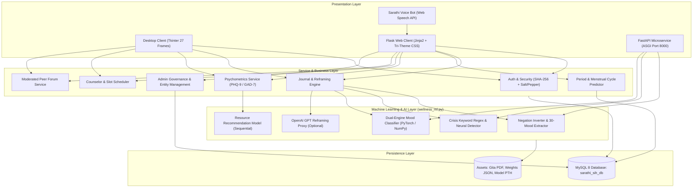

# Architecture Design (ARCHITECTURE.md) — BhagvadMood Journal

> **Document Version:** 2.1.0  
> **Architecture Pattern:** Multi-Tier Hybrid Architecture (Desktop Tkinter + Flask Web MVC + FastAPI ASGI Microservice) with Shared Domain Models, Neural Inference, and Local Relational Persistence

---

## 1. System Architecture Overview

BhagvadMood Journal is structured into four cohesive layers:
1. **Presentation Layer:**
   - **Desktop Client (`Main.py` / `gui_desktop/Main.py`):** 27 Tkinter views with embedded Matplotlib and PyMuPDF document rendering.
   - **Flask Web Client (`app.py` / `frontend/`):** Full-stack responsive Web application utilizing Jinja2 templates, tri-theme CSS variables, and ambient glow biofeedback.
   - **FastAPI Microservice (`fastapi_app.py`):** High-throughput asynchronous REST microservice running on port 8000 for low-latency scoring and agentic chats.
   - **Sarathi Voice Bot:** Client-side conversational agent utilizing the browser's native Web Speech API.
2. **Business & Application Layer:** Authentication controller, session tracking, cognitive reframing orchestration, menstrual cycle forecasting, psychometric calculation, peer forum moderation, and admin entity management.
3. **Machine Learning & AI Layer:** Context classification, dual-engine sentiment neural networks (PyTorch with portable NumPy fallback), crisis screening, and resource recommendation.
4. **Data Persistence Layer:** MySQL 8 relational database with connection pooling and schema migrations.

---

## 2. Component Breakdown

### 2.1 Web & Desktop Interface Synchronization
Both web and desktop clients share identical sentiment definitions, mood keywords, and Bhagavad Gita Shloka reframings:
- **Desktop Client:** Uses `tkinter.ttk` widgets styled with dark/light background states, rendering charts with `matplotlib.backends.backend_tkagg.FigureCanvasTkAgg`.
- **Web Client:** Employs CSS custom properties (`--bg-color`, `--card-bg`, `--text-primary`) bound to `data-theme="daylight"`, `data-theme="amber"`, or `data-theme="night"`, synchronizing ambient background tinting via `#mood-ambient-glow`.

### 2.2 FastAPI Asynchronous Microservice (`fastapi_app.py`)
Provides an independent ASGI microservice alongside Flask for asynchronous machine learning workloads:
- **Port:** `8000`
- **Endpoints:**
  - `GET /api/v1/health`: Microservice heartbeat.
  - `POST /api/v1/analyze`: Low-latency sentiment classification and Vedic cognitive reframing.
  - `POST /api/v1/chat`: Conversational agent interface with automatic crisis intervention.
  - `POST /api/v1/recommend-tier`: Asynchronous 5-feature biological/psychological triage.

### 2.3 Period Journal & Menstrual Wellness Module Architecture
The menstrual cycle subsystem operates through a closed analytical loop:
1. **User Ingestion:** Start/end dates, flow volume, physical symptoms, and mood tags are stored in `period_logs`.
2. **Cycle Analysis Algorithm:** Calculates the moving average interval between successive `start_date` entries:
   $$\bar{L}_{\text{cycle}} = \frac{1}{N-1} \sum_{i=1}^{N-1} (D_{i} - D_{i+1})$$
3. **Prediction Engine:** Forecasts the next cycle start date:
   $$D_{\text{next}} = D_{\text{latest}} + \bar{L}_{\text{cycle}}$$
4. **CSV Export Service:** Generates a streamable RFC 4180 compliant CSV file (`/api/period/export`) with explicit `Content-Disposition: attachment; filename=sarathi_period_journal_export_<user_id>.csv`.

### 2.4 Sarathi Voicebot Client Architecture
The conversational voice agent is embedded in the web layer via `static/js/main.js`:
- **Speech Recognition:** Uses `window.webkitSpeechRecognition` or `window.SpeechRecognition` with continuous listening and interim transcript filtering.
- **Voice Synthesis:** Employs `window.speechSynthesis` with pitch, rate, and Indian English / calming voice selection.
- **Route Filtering:** Restricted from mounting on authentication endpoints (`/login`, `/register`) to maintain clean page focus and credential privacy.

### 2.5 Admin Governance Service Architecture
The administrative dashboard (`/admin/dashboard`) encapsulates multi-table operational oversight:
- **Real-Time Client Filtering:** `filterAdminTable(tableId, query)` performs non-destructive DOM row filtering across Users, Counselors, Slots, Screenings, and Activity Logs.
- **Entity Lifecycle Controllers:**
  - `POST /admin/delete_counselor/<id>`: Safely disassociates and removes counselor profiles.
  - `POST /admin/delete_slot/<id>`: Cancels and removes unbooked or orphaned counselor time slots.
  - `POST /admin/delete_user/<id>`: Moderates and purges inactive or infringing student accounts.
- **Session Tab State:** Persisted across page refreshes via `sessionStorage.getItem('sarathi_active_admin_tab')`.
