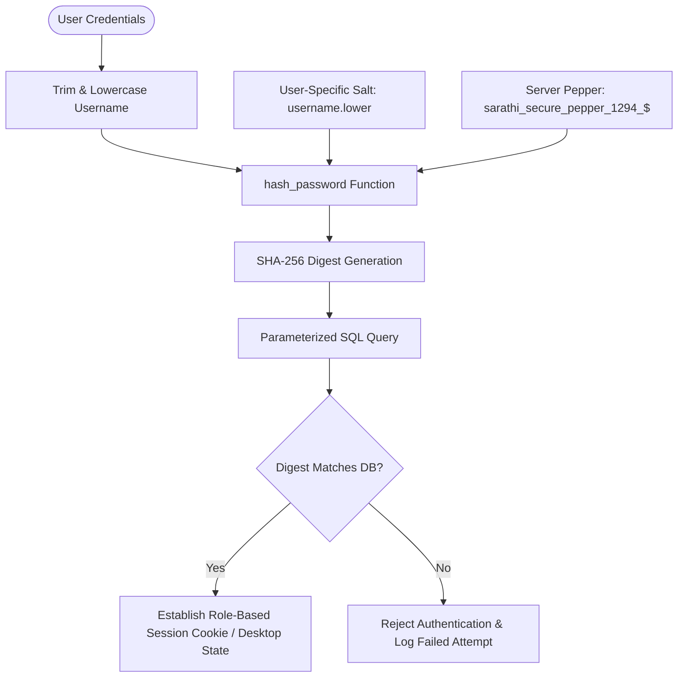

# Authentication & Security Protocols (AUTH.md) — BhagvadMood Platform

> **Document Version:** 2.1.0  
> **Security Standards:** Cryptographic Salting & Peppering (SHA-256), Role-Based Access Control (RBAC), SQL Prepared Statements, OWASP Compliance, Viewport Widget Isolation

---

## 1. Authentication Architecture

BhagvadMood Journal implements a defense-in-depth authentication framework designed to ensure user privacy, prevent credential compromise, and enforce strict role boundaries.



---

## 2. Cryptographic Password Hashing Algorithm

All passwords in BhagvadMood are hashed before being stored in the database. Raw passwords never touch database disks or log files.

```python
import hashlib

def hash_password(password: str, username: str = "") -> str:
    """
    Computes a deterministic, salted, and peppered SHA-256 hash.
    
    Salting Mechanism:
    - Pepper: Global hardcoded high-entropy secret ("sarathi_secure_pepper_1294_$")
    - Salt: Lowercase username guaranteeing distinct hashes for identical passwords across users.
    """
    pepper = "sarathi_secure_pepper_1294_$"
    combined = password + pepper + username.lower()
    return hashlib.sha256(combined.encode('utf-8')).hexdigest()
```

### Security Properties:
- **Pre-computation & Rainbow Table Resistance:** The inclusion of user-specific salt (`username.lower()`) prevents pre-computed rainbow table attacks.
- **Data Breach Containment:** If a user on another platform shares the same password, the hash stored in BhagvadMood remains unique.
- **Determinism:** Enables stateless credential comparison without transmitting keys.

---

## 3. Role-Based Access Control (RBAC)

The system defines three discrete access tiers:

| Role | Permissions & Access Boundaries | Boundary Enforcement Point |
| :--- | :--- | :--- |
| **Student / General User** | Compose reflections, complete PHQ-9/GAD-7 screenings, book counselor appointments, participate in peer forum, track menstrual cycles, export personal CSV. | `session.get('user_id')`, Desktop view filter |
| **Counselor** | View assigned user bookings, approve/reject sessions, publish calendar availability slots, review client mood summaries. | `session.get('role') == 'counselor'` |
| **Administrator** | Full platform governance: multi-table live search, counselor credentialing, counselor deletion, slot cancellation, user moderation, database integrity audits. | `session.get('role') == 'admin'` |

### Administrative Route Protection
All administrative mutation endpoints enforce strict role checks:
```python
@app.route('/admin/delete_counselor/<int:counselor_id>', methods=['POST'])
def admin_delete_counselor(counselor_id):
    if session.get('role') != 'admin':
        flash('Unauthorized: Administrator privileges required.', 'danger')
        return redirect(url_for('login'))
    # Proceed with parameterized deletion query...
```

---

## 4. Viewport Widget Isolation & Authentication Hardening

To prevent DOM eavesdropping, session fixation, or unexpected audio capture on unauthenticated portals:
1. **Sarathi Voicebot Suppression:** In `static/js/main.js`, the voicebot drawer is explicitly blocked from initializing on authentication routes:
   ```javascript
   if (window.location.pathname === '/login' || window.location.pathname === '/register') return;
   ```
2. **Session Reset on Login/Logout:** Calling `/logout` completely clears the server-side Flask session dictionary, invalidating cookies and mitigating session replay attacks.
3. **Parameterized SQL Queries:** Every database interaction in `app.py`, `Main.py`, and `database_setup.py` uses parameterized prepared statements (`%s` placeholders), completely mitigating SQL injection (SQLi).
