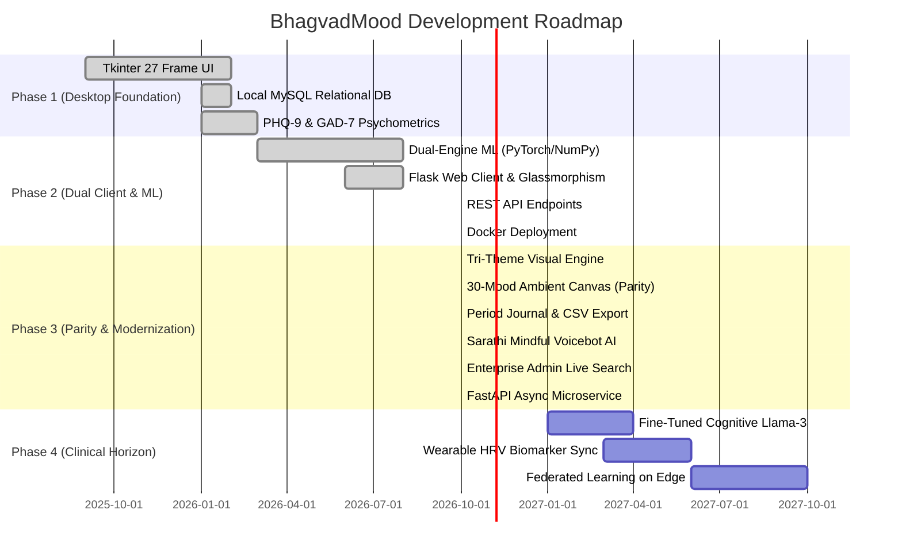

# Feature Development Roadmap (FEATURES.md) — BhagvadMood Platform

> **Document Version:** 2.1.0  
> **Development Lifecycle:** Iterative Milestone Progression from Local Desktop MVP to Enterprise Mental Health Ecosystem

---

## 1. Feature Progress Matrix

---

## 2. Completed Milestones (Phases 1, 2 & 3)

### 2.1 Multi-Persona Authentication & Privacy
- [x] Separate login workflows for Students, Counselors, and Administrators.
- [x] Salted and peppered cryptographic password hashing with SHA-256.
- [x] Tri-theme authentication portal (`/login` and `/register`) supporting Daylight, Amber, and Midnight palettes with verified high-contrast alert boxes.
- [x] 100% offline local MySQL persistence with zero third-party telemetry.

### 2.2 Dual-Client Experience & Visual Theming
- [x] **Desktop Client (`Main.py`):** 27 Tkinter frames featuring embedded Matplotlib analytics, treeview search, and in-app Bhagavad Gita PDF viewer.
- [x] **Web Client (`app.py`):** Responsive HTML5/CSS3 interface with Daylight (Sage), Warm Amber, and Midnight Cosmic tri-theme engine.
- [x] **30-Mood Dynamic Ambient Background Engine:** Viewport background dynamically illuminates with 30 distinct mood colors (`#mood-ambient-glow`), establishing full parity with Desktop GUI.

### 2.3 Period Journal & Menstrual Wellness Module
- [x] Menstrual cycle and symptom logger tracking flow intensity, physical discomforts (cramps, fatigue, headache, bloating), and mood tags.
- [x] Rolling cycle analysis calculating average period duration, historical interval length, and next period forecast.
- [x] One-click diagnostic CSV export (`/api/period/export`) for healthcare consultation.
- [x] Hormonal cycle Vedic cognitive reframing promoting physical patience and mindful rest.

### 2.4 Sarathi Mindful Voice Bot & Conversational Companion
- [x] Web Speech API integration (`initSarathiVoiceBot`) providing hands-free voice dictation and synthesized speech replies.
- [x] Conversational agent capable of cognitive reframing, calming affirmations, and guided breathing exercises.
- [x] Strict view isolation preventing the voicebot drawer from mounting on `/login` and `/register`.

### 2.5 Enterprise Admin Governance Console
- [x] Administrative overview dashboard (`/admin/dashboard`) with multi-table statistics (users, counselors, bookings, screenings, logs).
- [x] Real-time live client search (`filterAdminTable`) across all administrative data tables without page reloads.
- [x] Entity lifecycle management: counselor account deletion, slot cancellation, and user moderation.

### 2.6 Asynchronous High-Throughput Microservice
- [x] Dedicated FastAPI microservice (`fastapi_app.py`) on port 8000 providing low-latency REST endpoints (`/api/v1/health`, `/api/v1/analyze`, `/api/v1/chat`).
- [x] Interactive OpenAPI Swagger documentation available at `/docs`.

### 2.7 Cognitive Reframing & Vedic Wisdom
- [x] Multidimensional sentiment scoring (Polarity, Subjectivity, Negation Inversions).
- [x] Granular 30-mood taxonomy classification.
- [x] Situational context tagging (15 distinct life domains).
- [x] Contextual Bhagavad Gita Sanskrit Shloka pairing with authentic commentaries.

### 2.8 Machine Learning Dual-Engine & Crisis Safety
- [x] PyTorch deep neural network integration for sentiment and crisis inference.
- [x] Pure NumPy analytical He-initialized fallback networks (`TextNeuralNetwork`, `NumPySequential`) utilizing portable JSON weights.
- [x] Personalized 5-feature biological and psychological resource recommendation model.
- [x] Automated suicide ideation and acute medical distress pattern detection.
- [x] Immediate emergency intervention modal routing users to Tele-MANAS (`14416`), KIRAN (`1800-599-0019`), and Emergency (`112`).

### 2.9 Holistic Wellness Tools
- [x] Standardized PHQ-9 and GAD-7 psychometric screeners with automated scoring.
- [x] Counselor slot creation, availability booking, and SMTP notifications.
- [x] Anonymous peer support forum with category filters and live query search.
- [x] Gamified mindful to-do task manager and positive affirmation spin wheel.
- [x] 43/43 unit tests passing in pytest (100% test pass rate).
