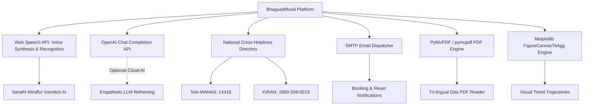

# Third-Party Integrations (INTEGRATIONS.md) — BhagvadMood

> **Document Version:** 2.1.0  
> **Ecosystem:** Web Speech API, External AI APIs, National Crisis Hotlines, SMTP Mailers, Document Parsers, Visual Rendering

---

## 1. External Integrations Matrix

---

## 2. Integration Specifications

### 2.1 Web Speech API (Sarathi Voice Bot)
- **Role:** Enables hands-free voice dictation of reflections and natural speech synthesis for cognitive reframing replies.
- **Client Script:** `static/js/main.js` (`initSarathiVoiceBot`).
- **Recognition Interface:** `window.SpeechRecognition` / `window.webkitSpeechRecognition`.
- **Synthesis Interface:** `window.speechSynthesis` and `SpeechSynthesisUtterance`.
- **Voice Selection:** Automatically matches calm Indian English or regional voices when available on the client device.
- **Privacy & Safety:** All speech processing occurs client-side in the browser; voice listening automatically turns off during idle states and is strictly excluded on `/login` and `/register`.

### 2.2 OpenAI Chat Completion API (Cognitive Reframing — Optional)
- **Role:** Optional cloud-assisted empathetic dialogue generation.
- **Library:** `openai>=1.12.0`
- **Environment Variable:** `OPENAI_API_KEY`
- **Model:** `gpt-3.5-turbo` (with JSON mode response format: `response_format={"type": "json_object"}`)
- **Timeout:** 5 seconds strict timeout.
- **Fault-Tolerance Policy:** If the key is missing, network is unavailable, or OpenAI times out, the platform gracefully switches to local deterministic NLP and Vedic Shlokas without error dialogs.

### 2.3 National Emergency Crisis Helplines
- **Role:** Direct safety intervention when crisis indicators or acute medical distress are detected.
- **Integrated Services:**
  - **Tele-MANAS:** National Tele Mental Health Programme of India (`14416` / `1-800-891-4416` — 24/7 Free & Confidential)
  - **Vandrevala Foundation Helpline:** `+91 9999666555` (24/7 Professional Counseling)
  - **KIRAN Helpline:** `1800-599-0019` (Ministry of Social Justice 24/7 Helpline)
  - **National Emergency Number:** `112` (Police, Ambulance, Fire)
- **Implementation:** Hardcoded directory within `HELPLINES` dictionary ensuring offline accessibility during total network outages.

### 2.4 SMTP Email Notification Engine
- **Role:** Sends appointment confirmations between users and counselors, and issues password reset verification codes.
- **Protocol:** Standard SMTP over TLS (Port 587) or SSL (Port 465).
- **Configuration Storage:** Managed dynamically via local `smtp_config.json` or environment variables (`SMTP_HOST`, `SMTP_PORT`, `SMTP_USER`, `SMTP_PASS`, `EMAIL_FROM`).

### 2.5 PyMuPDF Engine (`pymupdf`)
- **Role:** In-app rendering and page extraction for the tri-lingual Bhagavad Gita reference text (`BhagavadGita_Tri-lingual.pdf`).
- **Namespace:** `import pymupdf as fitz` (ensuring compatibility with modern PyMuPDF releases).

### 2.6 Matplotlib Embedded Canvas (`FigureCanvasTkAgg`)
- **Role:** Real-time generation of longitudinal mood trajectory plots within the Tkinter desktop GUI.
- **Canvas Container:** `FigureCanvasTkAgg` mounted within `Main.py` frames.
