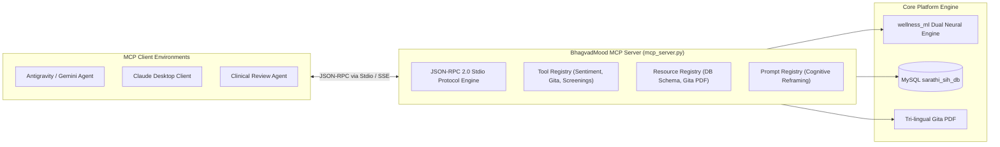

# Model Context Protocol Connection (MCP.md) — BhagvadMood

> **Document Version:** 2.0.0  
> **Protocol Specification:** Anthropic / Open Source Model Context Protocol (MCP) Standard  
> **Target Audience:** AI Coding Assistants (Antigravity, Claude Desktop, Cursor, Gemini CLI) & External Clinical Agents

---

## 1. Overview & Architecture

The **Model Context Protocol (MCP)** specification establishes an open standard for AI coding assistants and clinical agents to interact securely with the BhagvadMood platform. Through standardized MCP **Resources**, **Tools**, and **Prompts**, autonomous AI agents can analyze emotional trajectories, extract relevant Bhagavad Gita wisdom, execute psychometric calculations, and audit system integrity without direct SQL tampering.



---

## 2. Exposed MCP Resources

MCP Resources expose platform data sources as readable URIs:

| Resource URI | MIME Type | Description |
| :--- | :--- | :--- |
| `bhagvadmood://database/schema` | `text/markdown` | Current relational schema for all 10 tables including primary and foreign keys. |
| `bhagvadmood://gita/verses/{chapter}/{verse}` | `application/json` | Specific Bhagavad Gita Sanskrit shloka, transliteration, and English commentary. |
| `bhagvadmood://helplines/directory` | `application/json` | Verified national emergency helpline directory (Tele-MANAS, KIRAN, Emergency). |
| `bhagvadmood://metrics/system` | `application/json` | Aggregate anonymized operational metrics (total entries, active users, booking stats). |

---

## 3. Exposed MCP Tools

MCP Tools expose executable functions that agents can invoke with validated JSON schemas:

### 3.1 `analyze_sentiment`
- **Description:** Evaluates a reflective text entry, computing polarity, subjectivity, discrete mood, and crisis probability.
- **Input Schema:**
  ```json
  {
    "type": "object",
    "properties": {
      "text": { "type": "string", "description": "The user reflection text to evaluate" }
    },
    "required": ["text"]
  }
  ```
- **Output:**
  ```json
  {
    "mood": "anxious",
    "polarity": -0.42,
    "subjectivity": 0.75,
    "is_crisis": false,
    "context": "Academic Stress"
  }
  ```

---

### 3.2 `get_vedic_reframing`
- **Description:** Returns an authentic Bhagavad Gita Shloka and cognitive reframing prompt tailored to a given mood and situation.
- **Input Schema:**
  ```json
  {
    "type": "object",
    "properties": {
      "mood": { "type": "string", "description": "Classified mood identifier (e.g. anxious, sad, angry)" },
      "context": { "type": "string", "description": "Situational context label (e.g. Academic Stress)" }
    },
    "required": ["mood"]
  }
  ```

---

### 3.3 `calculate_screening_risk`
- **Description:** Computes clinical severity scores and risk categorization for PHQ-9 or GAD-7 inventories.
- **Input Schema:**
  ```json
  {
    "type": "object",
    "properties": {
      "tool_name": { "type": "string", "enum": ["PHQ-9", "GAD-7"] },
      "responses": {
        "type": "array",
        "items": { "type": "integer", "minimum": 0, "maximum": 3 },
        "description": "0=Not at all, 1=Several days, 2=More than half the days, 3=Nearly every day"
      }
    },
    "required": ["tool_name", "responses"]
  }
  ```

---

## 4. MCP Client Configuration Example

To connect BhagvadMood to an MCP client (such as Claude Desktop or Antigravity):

```json
{
  "mcpServers": {
    "bhagvadmood": {
      "command": "python",
      "args": ["c:/Users/Lenovo/Desktop/RECENT/Minor Project, python (.venv)/mcp_server.py"],
      "env": {
        "DB_HOST": "localhost",
        "DB_USER": "root",
        "DB_PASSWORD": "your_mysql_password"
      }
    }
  }
}
```

