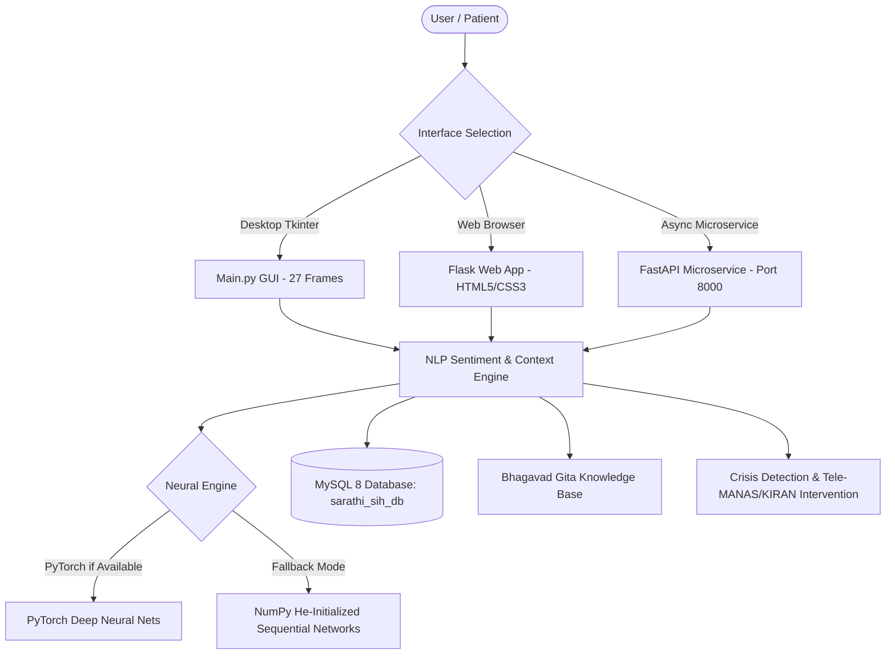

# Product Requirements Document (PRD) — BhagvadMood Journal (Sarathi)

> **Document Version:** 2.1.0  
> **Product Name:** BhagvadMood Journal / Sarathi Mental Wellness Platform  
> **Author & Lead Developer:** Chahat Modi  
> **Academic Scope:** Minor Project / Mental Health Monitoring & Action (MHMA) Framework  
> **Deployment Target:** Cross-platform Desktop (Tkinter), Web Platform (Flask / Docker), & Async Microservice (FastAPI)

---

## 1. Executive Summary & Product Vision

**BhagvadMood Journal** is a privacy-first, multi-tier mental wellness and reflective journaling ecosystem. It integrates clinical cognitive-behavioral diagnostic methodologies (PHQ-9, GAD-7) with evidence-backed cognitive reframing and ancient Vedic wisdom from the *Bhagavad Gita* to foster psychological resilience (*Sthitaprajna* and emotional equanimity).

Unlike conventional commercial mental health applications that compromise privacy by transmitting vulnerable reflections to cloud servers, BhagvadMood Journal provides **100% data sovereignty**, local relational persistence (MySQL 8), context-aware Natural Language Processing (NLP), dual-engine neural networks (PyTorch with portable NumPy fallback), voicebot interaction, dynamic ambient emotion theming, menstrual wellness logging, and automated crisis intervention with zero external telemetry required.

---

## 2. Problem Statement & Research Foundation

Clinical studies indicate five foundational deficits in existing digital mental health tools:

1. **Superficial Sentiment Misclassification:** Standard lexicon models (e.g., standard VADER) fail on complex clinical affect, double negations, and nuanced expressions (*"I am not entirely miserable today"*).
2. **Absence of Actionable Cognitive Reframing:** Conventional journaling apps merely store passive text without helping users identify and untangle cognitive distortions (catastrophizing, emotional reasoning).
3. **Data Exploitation & Privacy Risks:** Commercial SaaS wellness tools aggregate intimate behavioral patterns for advertising and commercial profiling.
4. **Cultural & Philosophical Disconnect:** Modern digital therapeutics almost exclusively employ Western cognitive models, ignoring the profound psychological equanimity principles formulated in Indian Vedic psychology.
5. **Lack of Integrated Biological Rhythm Awareness:** Women's emotional wellness is deeply influenced by hormonal and menstrual cycles, yet typical journaling apps isolate mental state from menstrual health.

---

## 3. User Personas

| Persona | Demographics | Core Needs & Frustrations | BhagvadMood Feature Mappings |
| :--- | :--- | :--- | :--- |
| **Aarav S.** | University Student (Age 20) | Academic burnout, exam anxiety, fear of failure, financial constraints | Student Persona login, PHQ-9 & GAD-7 tracking, Gita Shlokas on duty vs. outcome (*Nishkama Karma*), anonymous peer forum with search. |
| **Meera K.** | Tech Professional (Age 29) | Imposter syndrome, chronic workplace stress, cycle-related mood swings | Professional Persona login, 100% offline local storage, visual mood trajectory charts, time-boxed mini-goals, Period Journal. |
| **Dr. R. Verma** | Clinical Counselor | Managing client appointments, reviewing longitudinal mood trends | Counselor Dashboard, slot scheduling, booking approval workflow, risk tier categorization. |
| **System Admin** | Institutional Evaluator | System security, audit logging, aggregate user statistics | Enterprise Admin Dashboard, live table search, counselor credentialing, user moderation, slot cleanup. |

---

## 4. Key Functional Requirements (FR)

### FR-1: Multimodal User Management & Role-Based Access
- **FR-1.1:** Support separate user personas: Student, Counselor, and Administrator.
- **FR-1.2:** Secure authentication using SHA-256 with user-specific salting and server pepper.
- **FR-1.3:** Tri-theme authentication portal (`/login` and `/register`) supporting Daylight, Amber, and Midnight palettes with verified high-contrast alert boxes.

### FR-2: Reflective Journaling & Emotion Analysis
- **FR-2.1:** Freeform journal composition with real-time text analysis.
- **FR-2.2:** Multi-dimensional sentiment scoring: Polarity ($-1.0$ to $+1.0$), Subjectivity ($0.0$ to $1.0$), and Discrete Mood Classification (30 granular emotional states).
- **FR-2.3:** Automatic situational context categorization (15 distinct life domains): Academic Stress, Career/Work, Relationships, Health & Body, Financial Pressure, Self-Esteem, Loss & Grief, Burnout & Overwork, Social Anxiety & Loneliness, General Wellbeing.
- **FR-2.4:** Contextual Sanskrit Shloka pairing from the *Bhagavad Gita* with authentic English translations and philosophical guidance.

### FR-3: Machine Learning & Crisis Intervention
- **FR-3.1:** High-priority regex and neural crisis screening detecting suicide ideation, self-harm, and acute medical emergencies.
- **FR-3.2:** Immediate, unclosable alert modal with verified national helplines: Tele-MANAS (`14416`), KIRAN (`1800-599-0019`), and Emergency (`112`).
- **FR-3.3:** Personalized resource recommendation model taking age, gender, PHQ-9 score, GAD-7 score, and polarity to classify optimal intervention levels (Self-Care, Community Support, Professional Therapy, Crisis Intervention).

### FR-4: Clinical Psychometric Screenings
- **FR-4.1:** Standard 9-question PHQ-9 Depression assessment with automatic scoring ($0-27$) and clinical severity tiering.
- **FR-4.2:** Standard 7-question GAD-7 Anxiety assessment with automatic scoring ($0-21$) and clinical severity tiering.
- **FR-4.3:** Longitudinal historical trend storage linked to the user's relational profile.

### FR-5: Counselor Booking & Session Scheduling
- **FR-5.1:** Counselor slot creation and availability management.
- **FR-5.2:** User booking interface with specialization filtering and reason submission.
- **FR-5.3:** Automated SMTP confirmation notifications.

### FR-6: Advanced Period Journal, Hormonal Biofeedback & Clinical Diagnostics
- **FR-6.1:** Dedicated cycle and symptom logger tracking start/end dates, flow intensity, physical discomforts (cramps, fatigue, headaches, bloating), and mood tags.
- **FR-6.2:** Rolling cycle analysis calculating average period duration, historical interval length, and next period forecast.
- **FR-6.3:** Medical-grade RFC 4180 diagnostic CSV export (`/api/period/export`) for healthcare consultation.
- **FR-6.4:** Hormonal cycle Vedic cognitive reframing promoting physical patience and mindful rest.
- **FR-6.5:** **Clinical Condition Ingestion & Tracking:** Specialized diagnostic fields for PCOS / PCOD, PMDD (Premenstrual Dysphoric Disorder), PMS, and Endometriosis & Chronic Pelvic Pain.
- **FR-6.6:** **Biological Cycle Phase Biofeedback Engine:** Computes active cycle phase across 5 biological windows (Menstrual / Inner Winter, Follicular / Inner Spring, Ovulatory / Inner Summer, Early Luteal, and Late Luteal PMDD vulnerability window) with hormonal trajectory, nutrition, movement, and Vedic wisdom.
- **FR-6.7:** **Clinical Self-Screening Inventories:** Standardized DSM-5 PMDD diagnostic screener (`/api/period/screener/pmdd`) and Rotterdam criteria PCOS risk assessment (`/api/period/screener/pcos`).
- **FR-6.8:** **VAS Pain Severity Tracking (0-10):** Visual Analog Scale tracking pelvic cramps, lower back stiffness, and radiating discomfort with localized checkpoint tagging.
- **FR-6.9:** **Caregiver & Male Ally Mode:** Empowers male users and family caregivers to log cycles, record pain intensity, and receive phase-specific compassion guidance for multiple women in their lives (Wife, Daughter, Sister, Mother).

### FR-7: Sarathi Voice Bot & Conversational Assistant
- **FR-7.1:** Web Speech API integration (`initSarathiVoiceBot`) providing hands-free voice dictation and synthesized speech replies.
- **FR-7.2:** Real-time conversational agent capable of cognitive reframing, calming affirmations, and guided breathing exercises.
- **FR-7.3:** Strict view isolation preventing the voicebot drawer from mounting on `/login` and `/register`.

### FR-8: Tri-Theme Visual System & Dynamic 30-Mood Ambient Canvas
- **FR-8.1:** Tri-palette visual theme switcher: Daylight (Sage Natural aesthetic), Warm Amber, and Midnight Cosmic.
- **FR-8.2:** Parity with Desktop GUI: Viewport background dynamically illuminates with 30 distinct mood colors (`#mood-ambient-glow`) upon journal submission.
- **FR-8.3:** Global WCAG AA compliance with high-contrast text and interactive elements across all light and dark palettes.

### FR-9: Enterprise Admin Governance Console
- **FR-9.1:** Administrative overview dashboard (`/admin/dashboard`) with multi-table statistics (users, counselors, bookings, screenings, logs).
- **FR-9.2:** Real-time live client search (`filterAdminTable`) across all administrative data tables without page reloads.
- **FR-9.3:** Entity lifecycle management: counselor account deletion, slot cancellation, and user moderation.

### FR-10: Asynchronous High-Throughput Microservice
- **FR-10.1:** Dedicated FastAPI microservice (`fastapi_app.py`) on port 8000 providing low-latency REST endpoints (`/api/v1/health`, `/api/v1/analyze`, `/api/v1/chat`).
- **FR-10.2:** Full OpenAPI documentation available via `/docs`.

---

## 5. Non-Functional Requirements (NFR)

- **NFR-1 (Privacy & Sovereignty):** All user journal entries, credentials, and screening histories must remain stored locally on MySQL; no unencrypted telemetry or cloud offloading.
- **NFR-2 (Resilience & Portability):** The application must function fully even if PyTorch, CUDA, or specialized C-compilers are unavailable, seamlessly utilizing NumPy neural networks and offline JSON weights.
- **NFR-3 (Performance):** Sentiment analysis, context detection, and neural inference must complete in under 150ms per entry on standard consumer hardware.
- **NFR-4 (Security):** All passwords must be hashed using SHA-256 with user-specific salt and server pepper before persistence; SQL queries must use parameterized prepared statements to eliminate SQL injection vulnerabilities.
- **NFR-5 (Testability):** 100% automated test verification with pytest across all critical subsystems (43/43 tests passing).
