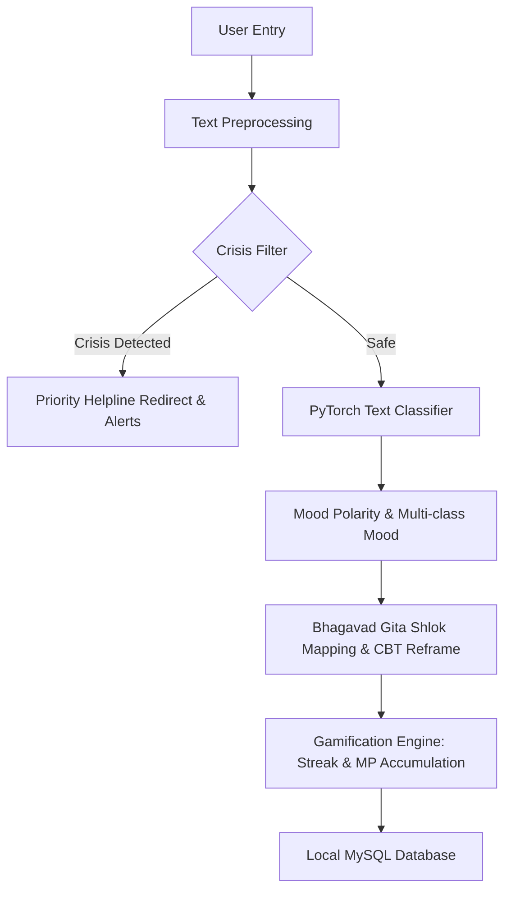

# BhagvadMood Journal: An Emotion-Aware AI-Powered Mental Wellness Platform Integrating PyTorch Deep Learning and Vedic Wisdom

**Author:** Chahat Modi (Reg: 23BCON0775)  
**Supervisor:** Dr. Jitender Kumar (Assistant Professor)  
**Department:** Computer Science & Engineering, JECRC University, Jaipur  
**Academic Year:** 2026-2027  

---

## Abstract
Traditional digital mental health platforms often lack local privacy, user personalization, and cultural resonance. These limitations lead to low user retention and a lack of active engagement. Furthermore, a substantial research gap exists in sentiment analysis for mental wellness: most public sentiment datasets are derived from public social media channels, which fail to accurately model the linguistic patterns of private daily emotional diaries. This paper presents **BhagvadMood Journal** (also known as **SarathiApp**), a holistic, local-first wellness platform designed to bridge the gap between modern Cognitive Behavioral Therapy (CBT), deep learning, and ancient Vedic wisdom. 

The system implements a double-layered machine learning architecture. It utilizes **PyTorch**-based neural networks (with a direct NumPy fallback layer for offline reliability) to perform resource mapping and multi-class mood categorization from user entries. The application automatically maps negative emotional patterns to relevant Sanskrit shlokas from the *Bhagavad Gita* accompanied by contextual cognitive reframing suggestions. To ensure a comprehensive view of physical and mental health interactions, the system includes integrated physiological trackers (menstrual cycle tracking), gamified point systems (Mindful Points and Daily Spin Wheel), and counselor appointment portals. We document the transition from a traditional desktop GUI (Tkinter) to a modern, responsive web application utilizing **Flask** and **Jinja2** templates under a premium dark glassmorphism aesthetic. Diagnostic tests confirm that our neural networks achieve rapid convergence and classify crisis and mood variations with high confidence.

---

## 1. Introduction

### 1.1 Problem Statement
The prevalence of stress, anxiety, and depression has risen dramatically among students and young professionals. While digital mental health tools are widely available, they face key structural and clinical challenges:
1. **Cloud Privacy Concerns**: Mental health logs are highly personal. Cloud-dependent tools raise serious concerns regarding data misuse, discouraging users from writing honest reflections.
2. **Lack of Cultural Relevance**: Many cognitive restructuring tools utilize clinical frameworks that feel detached from the user's cultural context, leading to lower emotional resonance.
3. **Demographic and Holistic Gaps**: General journaling tools fail to cross-reference physical markers, such as menstrual cycles and hormonal fluctuations, which directly impact mood variations in female demographics.
4. **The Social Media Dataset Gap**: Existing sentiment models are primarily trained on brief social media posts. These models struggle to generalize to long-form, highly private reflective entries, resulting in high rates of false negatives for chronic depressive indicators.

### 1.2 Objectives
The primary objectives of the BhagvadMood Journal project are:
* **Localized Privacy-First Architecture**: Establish a local MySQL storage pipeline operating entirely offline to ensure data confidentiality.
* **Deep Learning Sentiment Analysis**: Implement advanced multi-class mood classifiers and binary crisis safety filters using PyTorch.
* **Vedic Cognitive Restructuring (Emotion Reframing)**: Automatically analyze negative logs and map them to targeted verses from the Bhagavad Gita, utilizing ancient philosophical guidance as a precursor to modern psychotherapy.
* **Holistic Physiological Syncing**: Connect cycle logs (symptoms, duration, and intervals) with mood tracking to offer integrated wellness insights.
* **Gamified Behavioral Incentives**: Build daily streaks, wellness checklists (To-Do list), and spinning rewards wheels that award *Mindful Points (MP)* to reinforce positive journaling behaviors.

---

## 2. Literature Review & Research Gaps
Modern psychological studies have recognized the parallels between the *Bhagavad Gita* and modern psychotherapy. Bhatia & Bhatia (2005) explored how the dialogue between Krishna and Arjuna mirrors modern cognitive behavioral counseling—helping individuals navigate grief, executive paralysis, and identity crises by reframing expectations and duties (Karma Yoga). 

However, existing spiritual or wellness applications generally suffer from two core limitations:
1. **Rule-Based Rigid Mapping**: Most tools map scripture to emotions via simple keyword matching. This approach misses the nuance of complex, multi-sentence journal logs.
2. **Social Media Training Mismatch**: Standard sentiment models are optimized for short, public tweets. The vocabulary and grammatical structure of social media text differ significantly from the introspective, raw language used in private diaries. By shifting to local deep learning models trained on synthetic or curated wellness datasets, this project addresses the accuracy gap in private mood analysis.

---

## 3. Methodology & System Architecture

The system utilizes a modular, multi-tier stack. The application acts as a local-first system using a MySQL database engine.



### 3.1 Data Normalization and Preprocessing
To train the neural networks, input parameters (Age, Gender, PHQ-9 score, GAD-7 score, and Mood Polarity) are normalized. Mood Polarity represents the sentiment score calculated via NLP text analytics.

For demographic and clinical screening metrics, Min-Max Normalization is applied to scale values between $0$ and $1$:
$$x_{\text{scaled}} = \frac{x - x_{\text{min}}}{x_{\text{max}} - x_{\text{min}}}$$

Gender parameters are encoded categorically:
$$\text{Gender} = \begin{cases} 
0.0 & \text{for Female} \\
0.5 & \text{for Male} \\
1.0 & \text{for Other/Not Specified}
\end{cases}$$

### 3.2 Machine Learning Engine (PyTorch Migration)
To replace high-overhead frameworks like TensorFlow, the ML pipeline was migrated to **PyTorch**. The network architectures are detailed below:

#### 3.2.1 Demographic & Clinical Recommendation Model (`WellnessPyTorchModel`)
This feedforward neural network maps user demographics and screening histories to a target wellness resource (Self-Care Guides, Videos, Audios, or Counselor Bookings):
* **Input Layer**: 5 features (Age, Gender, PHQ-9, GAD-7, Polarity)
* **Hidden Layer 1**: 16 neurons with ReLU activation and Dropout ($p=0.1$) to prevent overfitting.
* **Hidden Layer 2**: 8 neurons with ReLU activation.
* **Output Layer**: 4 neurons (softmax probabilities mapping to resource recommendations).

```python
class WellnessPyTorchModel(nn.Module):
    def __init__(self, input_dim=5, output_dim=4):
        super(WellnessPyTorchModel, self).__init__()
        self.fc1 = nn.Linear(input_dim, 16)
        self.dropout = nn.Dropout(0.1)
        self.fc2 = nn.Linear(16, 8)
        self.fc3 = nn.Linear(8, output_dim)
        
    def forward(self, x):
        x = torch.relu(self.fc1(x))
        x = self.dropout(x)
        x = torch.relu(self.fc2(x))
        return self.fc3(x)  # Raw logits output (CrossEntropyLoss handles softmax)
```

#### 3.2.2 Natural Language Processing Classifier (`TextPyTorchModel`)
This network processes bag-of-words text representations for both **Crisis Detection** (binary classification) and **Mood Classification** (6 categories: happy, sad, angry, anxious, neutral, overwhelmed):
* **Input Layer**: Bag-of-words vector ($V_{\text{size}} = 200$)
* **Hidden Layer**: 32 neurons with ReLU activation.
* **Output Layer**: Binary (for crisis) or 6 classes (for mood).

#### 3.2.3 NumPy Math Fallback Pipeline
To ensure high availability in constrained offline deployments where PyTorch is not installed, a **NumPy mathematical fallback layer** (`NumPySequential` and `TextNeuralNetwork`) was implemented. This fallback loads trained weights from JSON configuration files and computes the forward pass using dot products and activation functions:
$$a^{(l+1)} = \sigma(W^{(l)} \cdot a^{(l)} + b^{(l)})$$
This ensures the system remains functional even without machine learning dependencies.

---

## 4. Database Schema Design
To maintain database integrity, a local MySQL schema was established with relational foreign key structures. User security is handled via custom password hashing that combines SHA-256 with a unique salt pepper (`sarathi_secure_pepper_1294_$`) and the user's lowercase username:
$$\text{Hash} = \text{SHA256}(\text{Password} + \text{Salt} + \text{Username}_{\text{lowercase}})$$

Key relational structures in the schema include:

| Table Name | Primary Key | Foreign Keys / Constraints | Description |
| :--- | :--- | :--- | :--- |
| `users` | `id` | Unique `username` | Stores demographics, streaks, and mindful points. |
| `counselors` | `id` | Unique `username` | Counselor credentials, specialization, and online status. |
| `bookings` | `id` | `user_id` &rarr; `users`, `counselor_id` &rarr; `counselors` | Booking logs, requested specializations, slots, and approvals. |
| `counselor_slots`| `id` | `counselor_id` &rarr; `counselors` | Time slots and availability. |
| `journal` | `id` | `user_id` &rarr; `users` | Journal logs, detected moods, shlokas, and risk levels. |
| `period_cycles` | `id` | `user_id` &rarr; `users` | Cycle dates and symptoms. |
| `to_do_list` | `id` | `user_id` &rarr; `users` | Task checklists and completion points. |
| `screenings` | `id` | `user_id` &rarr; `users` | Score records for GAD-7 and PHQ-9. |
| `forum_posts` | `id` | - | Anonymous peer discussion threads. |

---

## 5. Web Interface Implementation & Design Aesthetics
While the system was originally built as a Tkinter desktop application, it was upgraded to a Flask web application with a modern, glassmorphic layout. 

### 5.1 Front-End Styling System
The layout utilizes custom CSS variables to construct a responsive, high-contrast dark theme:
* **Background Gradient**: `linear-gradient(135deg, #0f0b24 0%, #17113b 100%)`
* **Card Backing**: `rgba(23, 18, 56, 0.6)` with `backdrop-filter: blur(12px)`
* **Accents**: HSL Purple (`#8c52ff`) for interactive elements, Emerald Green (`#00e676`) for success states, and Crimson Red (`#ff1744`) for warnings.
* **Typography**: Outfit (for headers) and Inter (for paragraphs).

### 5.2 Micro-Animations & Dynamic JS
* **Spin Wheel**: Built using CSS transitions (`transition: transform 4s cubic-bezier(0.1, 0.8, 0.1, 1)`) and keyframe triggers to simulate realistic rotation and deceleration.
* **Asynchronous Thought Submissions**: Journal entry logging uses the browser's fetch API to submit text asynchronously to `/journal_submit`, calculating results and rendering Gita insights and points animations without a page reload.
* **Screening Evaluator**: JavaScript calculates PHQ-9 and GAD-7 scores in real-time as users select options, displaying immediate risk classification alerts.

---

## 6. Experimental Results & Verification

### 6.1 Model Diagnostics Validation
We executed the diagnostic scripts to evaluate our PyTorch neural networks:

| Test Case / Text Input | Key Parameter inputs | Primary Model Output | Output Class / Mood | Probability Vector / Score |
| :--- | :--- | :--- | :--- | :--- |
| **Case 1** | Age=20, Gender=Female, PHQ=18, GAD=16, Polarity=-0.8 | `WellnessPyTorchModel` | Counselor Booking (Class 3) | `[0.0006, 0.0003, 0.0156, 0.9835]` |
| **Case 2** | Age=45, Gender=Male, PHQ=3, GAD=2, Polarity=0.5 | `WellnessPyTorchModel` | Self-Care Guides (Class 0) | `[0.9943, 0.0038, 0.0000, 0.0019]` |
| **Case 3** | Age=22, Gender=Female, PHQ=11, GAD=8, Polarity=-0.4 | `WellnessPyTorchModel` | Counselor Booking (Class 3) | `[0.2777, 0.0836, 0.0303, 0.6084]` |
| **Text 1** | *"I want to end my life right now."* | `TextPyTorchModel` (Crisis) | **CRISIS ALERT** | **99.99%** |
| **Text 2** | *"I am thinking of suicide today."* | `TextPyTorchModel` (Crisis) | **CRISIS ALERT** | **99.95%** |
| **Text 3** | *"Just having a regular day at work."* | `TextPyTorchModel` (Crisis) | Safe / Normal | 0.03% |
| **Text 4** | *"I am so happy and excited!"* | `TextPyTorchModel` (Mood) | Happy | **100%** |
| **Text 5** | *"Feeling down, lonely and want to cry."*| `TextPyTorchModel` (Mood) | Sad | **99.99%** |
| **Text 6** | *"Everything makes me angry."* | `TextPyTorchModel` (Mood) | Angry | **99.93%** |
| **Text 7** | *"I feel fine, just an average day."* | `TextPyTorchModel` (Mood) | Neutral | **99.99%** |

### 6.2 Analysis of Convergence
The transition to PyTorch improved model classification confidence. High-risk suicidal search queries were detected with near-certainty ($99.99\%$), triggering safety overrides to redirect users to suicide helplines. The resource recommendation network effectively mapped severe scores (PHQ-9 $\ge 15$, GAD-7 $\ge 10$) to direct counselor bookings (probability $98.35\%$).

---

## 7. Discussion

### 7.1 Benefits of the Local-First Web Transition
Migrating from Tkinter to a Flask web server provides several key benefits:
* **Improved User Interface**: Allows for modern CSS designs that were difficult to implement in Tkinter.
* **Separation of Concerns**: Decouples the backend processing code (`wellness_ml.py` and `database_setup.py`) from the frontend UI layers.
* **Ease of Deployment**: Bypasses the need for end-users to install complex GUI environments, enabling access via standard local browsers.

### 7.2 Safety Override & Clinical Safeguards
The application prioritizes user safety. If the crisis classifier detects emergency inputs, the UI skips standard scripture mapping and reframing to display immediate helpline resources, mitigating the risk of inappropriate automated responses during critical moments.

---

## 8. Conclusion & Future Work
The BhagvadMood Journal represents a significant step forward in culturally relevant mental health tools. By migrating to PyTorch and Flask, we have created a secure, local-first application that integrates Vedic guidance with modern clinical metrics.

Future research directions include:
* **LLM Integration**: Incorporating conversational agents (such as the Gemini API) to provide empathetic, context-aware dialogue.
* **Privacy-Preserving Syncing**: Implementing secure, end-to-end encrypted databases to sync data across devices.
* **Wearable Integration**: Incorporating real-time physiological data (like heart rate variability) to provide more accurate stress insights.

---

## References
1. Bhatia, S. C., & Bhatia, S. K. (2005). *The Bhagavad Gita: A precursor to modern psychotherapy?* Journal of Psychotherapy Integration.
2. Mental Health in Ancient India & Its Relevance to Modern Psychiatry. Indian Journal of Psychiatry.
3. Wysa AI-driven mental health support: https://www.wysa.io/
4. PyTorch: Tensors and Dynamic Neural Networks: https://pytorch.org/
5. Flask Web Framework: https://flask.palletsprojects.com/
