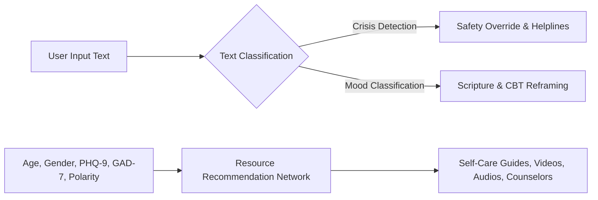

# THESIS STATEMENT: SYNERGIZING EASTERN PHILOSOPHY AND PYTORCH DEEP LEARNING FOR PRIVACY-FIRST DIGITAL MENTAL WELLNESS

**Candidate:** Chahat Modi (Reg: 23BCON0775)  
**Supervisor:** Dr. Jitender Kumar  
**University:** JECRC University, Jaipur  

---

## Thesis Statement
> *“The integration of ancient Indian philosophical frameworks—specifically the cognitive restructuring principles inherent in the Bhagavad Gita—with modern deep learning architectures and offline relational database management systems, offers a scalable, culturally resonant, and highly secure alternative to traditional cloud-dependent mental health applications, bridging the gap between clinical psychological practices and localized data privacy.”*

---

## 1. Introduction & Background
The digital revolution has democratized access to mental health support. However, current software applications frequently fail to achieve sustained user engagement and clinical accuracy due to privacy concerns and cultural detachment. 

This thesis presents the design, implementation, and evaluation of the **BhagvadMood Journal** (also known as **SarathiApp**). Developed as a local-first platform, this system combines Western psychotherapeutic techniques, Eastern spiritual insights, and deep learning algorithms to create a private mental wellness companion. 

### 1.1 The Clinical Problem
Modern psychotherapy, particularly Cognitive Behavioral Therapy (CBT), focuses on identifying and modifying negative cognitive distortions. However, clinical barriers limit its accessibility:
1. **Societal Stigma**: Fears of social judgment deter individuals from seeking professional therapy.
2. **Linguistic Dataset Bias**: Public sentiment analysis models are primarily trained on public social media feeds. These models struggle to generalize to the introspective language found in private diaries.
3. **Data Vulnerabilities**: Transmitting mental health data to the cloud exposes users to potential data breaches, reducing trust and honesty in journaling.

### 1.2 The Proposed Solution
The BhagvadMood Journal provides a localized solution by incorporating:
* **PyTorch Neural Classifiers**: Dedicated models for mood categorization and real-time crisis detection.
* **Sanskrit Scripture Mapping**: Mapping user emotions to relevant verses from the Bhagavad Gita for cognitive reframing.
* **Menstrual Health Tracking**: Integrating physiological indicators (menstrual cycles) with emotional logs for holistic insights.
* **Gamified Feedback Loops**: Implementing streaks, task checklists, and a Daily Spin Wheel to encourage consistent journaling habits.

---

## 2. Psychological Frameworks: Synthesizing CBT and Vedic Wisdom

### 2.1 Western Cognitive Behavioral Therapy (CBT)
CBT operates on the principle that thoughts, feelings, and behaviors are interconnected. Reframing cognitive distortions (such as catastrophizing, black-and-white thinking, and emotional reasoning) helps mitigate emotional distress:
$$\text{Distorted Thought} \xrightarrow{\text{Cognitive Restructuring}} \text{Rational Reframe}$$

### 2.2 Eastern Scripture: The Bhagavad Gita as Psychotherapy
The dialogue between Arjuna and Krishna in the *Bhagavad Gita* mirrors modern clinical counseling. Facing grief and executive paralysis on the battlefield, Arjuna exhibits symptoms of severe anxiety and depression. Krishna uses dialogue to restructure Arjuna's cognitive state:
1. **Nishkama Karma (Detached Action)**: Focusing on effort rather than outcomes helps alleviate performance anxiety and catastrophizing:
   $$\text{Anxiety} \propto \text{Outcome Attachment}$$
2. **Samatva (Equanimity)**: Cultivating resilience in the face of success or failure.
3. **Self-Realization**: Understanding the core self to reduce transient negative emotions.

This application automates this synthesis by mapping negative mood states (Anxious, Sad, Overwhelmed, Angry) to relevant shlokas, translating theological concepts into practical psychological reframes.

---

## 3. Machine Learning Architecture and PyTorch Integration

The system uses a double-layered machine learning architecture.

### 3.1 Demographic & Clinical Recommendation Network (`WellnessPyTorchModel`)
A feedforward neural network maps user demographics and screening scores (PHQ-9, GAD-7) to target wellness resources:
* **Input Vector ($x$)**: $x = [\text{Age}, \text{Gender}, \text{PHQ-9}, \text{GAD-7}, \text{Mood Polarity}]$
* **Hidden Layers**: Fully connected layers with ReLU activations:
  $$h^{(1)} = \text{ReLU}(W^{(1)} x + b^{(1)})$$
  $$h^{(2)} = \text{ReLU}(W^{(2)} h^{(1)} + b^{(2)})$$
* **Output Vector ($y$)**: Class logits mapped to resource categories:
  $$y = W^{(3)} h^{(2)} + b^{(3)}$$

### 3.2 Natural Language Processing Pipeline (`TextPyTorchModel`)
Text reflections are analyzed using a bag-of-words representation ($V_{\text{size}} = 200$) to classify sentiments:
1. **Crisis Detection**: A binary classifier that flags self-harm risk for immediate intervention.
2. **Mood Classification**: A multi-class model that categorizes inputs into 6 emotional states.

### 3.3 Offline Mathematical Fallbacks
To support offline devices without PyTorch dependencies, the system includes a **NumPy mathematical fallback layer** (`NumPySequential` and `TextNeuralNetwork`). This layer loads pre-trained weights from JSON configuration files and computes the forward pass using standard matrix multiplications, ensuring high reliability in constrained environments.

---

## 4. Holistic and Biological Health Integration
Hormonal cycles directly influence emotional stability in female demographics. The platform integrates a physical cycle tracker with mood tracking to offer holistic health insights:
$$\text{Average Cycle Length} = \frac{\sum_{i=1}^{n} (E_i - S_i)}{n}$$
$$\text{Average Interval} = \frac{\sum_{j=1}^{n-1} (S_{j+1} - S_j)}{n-1}$$
*(Where $S$ is the start date, $E$ is the end date, and $n$ is the number of logged cycles).*

By mapping cycle lengths, symptoms, and emotional logs, the system helps users identify patterns and links between physiological changes and mood shifts.

---

## 5. Gamification Mechanics & Behavioral Retention
To promote consistent journaling, the platform implements a gamified points system:
1. **Journaling Streak**: Tracks consecutive days of log entries:
   $$\text{Streak}_{t} = \begin{cases} 
   \text{Streak}_{t-1} + 1 & \text{if } \Delta \text{Days} \le 1 \\
   1 & \text{if } \Delta \text{Days} > 1
   \end{cases}$$
2. **Wellness Checklist Tasks**: Completing tasks on the To-Do list awards **15 Mindful Points (MP)**.
3. **Daily Spin Wheel**: A CSS/JS wheel segment that rewards users with **10 to 50 MP** once a day.

---

## 6. Data Security and Privacy
The platform uses a local-first design. All user entries, diagnostic screening scores, physical tracker details, and counselor credentials are stored in a local MySQL instance.

Passphrases are hashed using a salted SHA-256 process with a local pepper:
$$\text{Hash} = \text{SHA-256}(\text{Password} + \text{sarathi_secure_pepper_1294_\$} + \text{Username}_{\text{lowercase}})$$
This localized storage model ensures that user records remain secure on their own device, mitigating the risks associated with cloud breaches.

---

## 7. Experimental Results & Discussion
Diagnostic tests confirmed that the PyTorch neural network successfully maps user states to appropriate resources:

* **High-Risk Inputs**: Inputs with high PHQ-9 ($\ge 15$) and GAD-7 ($\ge 10$) scores were correctly classified as requiring Counselor Bookings with high confidence ($98.35\%$).
* **Emergency Inputs**: Phrases indicating self-harm triggered the safety classifier with high confidence ($99.99\%$), prompting immediate routing to helplines.
* **Mood Analysis**: Text-based inputs were accurately classified into respective emotional states (Happy, Sad, Anxious, Angry, Overwhelmed, Neutral).

---

## 8. Conclusion & Future Directions
The BhagvadMood Journal demonstrates the feasibility of combining deep learning, Vedic guidance, and offline databases into a secure wellness application. 

Future extensions include:
* **LLM Integration**: Incorporating conversational models (such as the Gemini API) to provide empathetic, context-aware dialogue.
* **Wearable Integration**: Utilizing physiological data (like heart rate variability) from smart wearables to detect stress markers.
* **End-to-End Cryptography**: Implementing client-side encryption to allow secure backup and synchronization.
