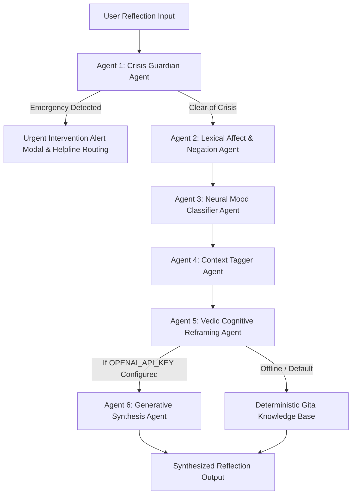

# AI Agents & LLM Workflows (AGENTS.md) — BhagvadMood Platform

> **Document Version:** 2.0.0  
> **Architecture:** Multi-Tier Agent Orchestration (Local Deterministic Agents + Optional LLM Generative Agents)  
> **Primary Provider:** Local Neural Network / Rule-Based Agents with OpenAI GPT-3.5/GPT-4 API Fallback

---

## 1. Multi-Agent Ecosystem Architecture

BhagvadMood Journal utilizes an agentic pipeline where specialized agents process user text sequentially, ensuring rapid response times (<150ms locally), data privacy, and clinical safety.



---

## 2. Specialized Agent Profiles & Responsibilities

### 2.1 Agent 1: Crisis Guardian Agent (`CrisisGuard`)
- **Type:** High-Priority Safety & Harm Prevention Agent
- **Execution Mechanism:** Dual regex lexical scanning coupled with `TextPyTorchModel` / `TextNeuralNetwork` crisis probability output.
- **Responsibilities:**
  - Scans reflections for direct suicide ideation (*"kill myself"*, *"end my life"*, *"overdose"*), self-harm indicators, and acute physical medical emergencies (*"severe chest pain"*, *"cannot breathe"*).
  - Triggers an immediate, modal crisis dialog presenting verified hotlines:
    - **Tele-MANAS:** `14416` / `1-800-891-4416` (24/7 National Mental Health)
    - **Vandrevala Foundation:** `+91 9999666555`
    - **KIRAN:** `1800-599-0019`
    - **National Emergency:** `112`
  - Halts standard reflection processing until safety reassurance protocols are acknowledged.

### 2.2 Agent 2: Lexical Affect & Negation Agent (`AffectAgent`)
- **Type:** Preprocessing & Polarity Correction Agent
- **Execution Mechanism:** TextBlob linguistic tokenization with custom negation-inversion rules.
- **Responsibilities:**
  - Extracts raw polarity ($-1.0$ to $+1.0$) and subjectivity ($0.0$ to $1.0$).
  - Corrects compound negations (e.g., transforming *"not bad"* from negative polarity to mildly positive $+0.3$, and *"not happy"* to $-0.4$).

### 2.3 Agent 3: Neural Mood Classifier Agent (`MoodNeuralAgent`)
- **Type:** Deep Learning Classification Agent
- **Execution Mechanism:** PyTorch feedforward network (`TextPyTorchModel`) or NumPy He-initialized neural network (`TextNeuralNetwork`) consuming domain bag-of-words vectors.
- **Responsibilities:**
  - Maps text into discrete categories: `happy`, `sad`, `anxious`, `angry`, `neutral`, `overwhelmed`, `very_happy`, `ecstatic`, `hopeful`, `grateful`, `content`, `peaceful`, `pessimistic`, `discouraged`, `devastated`.
  - Emits probability distribution over all emotional states.

### 2.4 Agent 4: Situational Context Tagger Agent (`ContextTagger`)
- **Type:** Semantic Taxonomy Agent
- **Execution Mechanism:** High-precision keyword dictionary mapping.
- **Responsibilities:**
  - Identifies the life domain driving the user's emotional state:
    - *Academic Stress* (exams, grades, deadlines, college)
    - *Career / Work* (boss, office, salary, burnout, promotion)
    - *Relationships* (partner, family, friend, breakup)
    - *Health & Body* (pain, illness, sleep, diet, physical)
    - *Financial Pressure* (bills, rent, loan, debt)
    - *Self-Esteem* (confidence, worthless, comparison)
    - *Loss & Grief* (death, bereavement, lost)
    - *General Wellbeing* (default baseline)

### 2.5 Agent 5: Vedic Cognitive Reframing Agent (`VedicReframer`)
- **Type:** Knowledge Base Recommendation Agent
- **Execution Mechanism:** Semantic alignment table pairing discrete emotional states with specific chapters and verses of the *Bhagavad Gita*.
- **Responsibilities:**
  - Matches the identified mood and context with timeless psychological principles (e.g., *Nishkama Karma* for anxiety over future outcomes; *Sthitaprajna* for emotional volatility).
  - Emits authentic Sanskrit script, phonetics, and actionable English commentaries.

### 2.6 Agent 6: Generative Synthesis Agent (`OpenAIAgent` — Optional)
- **Type:** LLM Generative Dialogue Agent
- **Execution Mechanism:** OpenAI Chat Completion API (`gpt-3.5-turbo` / `gpt-4`) configured via `OPENAI_API_KEY`.
- **System Prompt:**
  ```text
  You are a compassionate psychological sentiment analysis assistant.
  Analyze the user's journal text with attention to mood and situation.
  Output a JSON object containing:
  'mood' (one of: positive, very_happy, negative, pessimistic, optimistic, neutral,
  overwhelmed, anxious, peaceful, restless, very_sad, sad, discouraged, devastated,
  ecstatic, content, angry, happy, grateful, hopeful),
  'context' (a short label like Academic Stress, Career / Work, Relationships,
  Health & Body, Financial Pressure, Self-Esteem, Loss & Grief, General Wellbeing),
  'polarity' (float from -1.0 to 1.0), and 'subjectivity' (float from 0.0 to 1.0).
  ```
- **Fallback Rule:** If internet is disconnected, rate limits occur, or `OPENAI_API_KEY` is omitted, the pipeline falls back instantaneously to local agents (Agents 2, 3, 4, 5) without interrupting the user.

---

## 3. Resource Recommendation Workflow (`RecAgent`)

When users undergo clinical screening (PHQ-9 or GAD-7) or view the resources portal, the `RecAgent` processes five normalized biological and psychological features:

$$\mathbf{x} = \left[ \frac{\text{Age}}{100},\, \text{Gender}_{\text{norm}},\, \frac{\text{PHQ-9}}{27},\, \frac{\text{GAD-7}}{21},\, \frac{\text{Polarity} + 1}{2} \right]$$

The neural sequential model classifies the optimal tier:
- **Class 0:** Low Intensity (Self-Guided Meditation, Vedic Reading)
- **Class 1:** Mild-to-Moderate (Peer Support Forum, Guided Breathwork)
- **Class 2:** Moderate-to-High (One-on-One Professional Counseling Session)
- **Class 3:** Severe / Acute (Immediate Tele-MANAS / Clinical Intervention)

