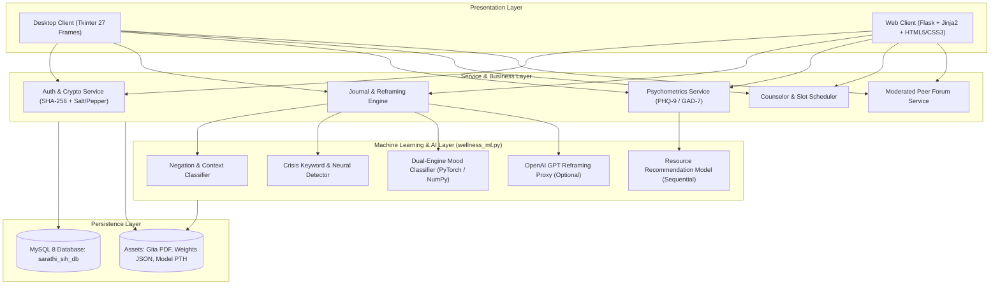
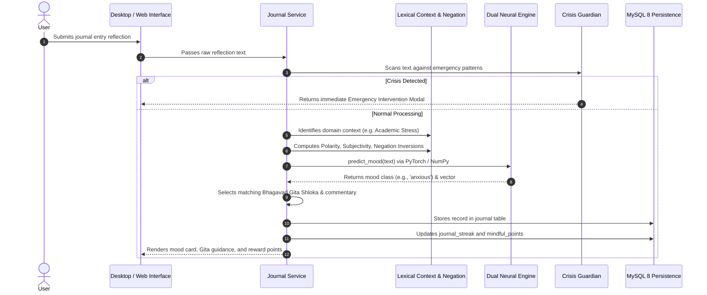

# Architecture Design (ARCHITECTURE.md) — BhagvadMood Journal

> **Document Version:** 2.0.0  
> **Architecture Pattern:** Dual-Client Layered Architecture (Desktop Tkinter + Web Flask) with Shared Domain, ML Inference, and Relational Persistence

---

## 1. System Architecture Overview

BhagvadMood Journal is structured into four cohesive layers:
1. **Presentation Layer:** Dual interfaces offering native desktop performance (`Main.py`) and browser-based remote access (`app.py`).
2. **Business & Application Layer:** Authentication controller, session tracking, cognitive reframing orchestration, psychometric calculation, and forum moderation.
3. **Machine Learning & AI Layer:** Context classification, dual-engine sentiment neural networks (PyTorch with portable NumPy fallback), crisis screening, and resource recommendation.
4. **Data Persistence Layer:** MySQL 8 relational database with connection pooling and schema migrations.

---

## 2. Component Breakdown

### 2.1 Desktop Client (`Main.py`)
- **Class `SarathiApp` (`tk.Tk`):** Root window managing global state (authenticated `user_id`, `username`, `mindful_points`, `user_streak`).
- **Frame Controller:** `show_frame(page_name)` manages lazy and active rendering across 27 distinct views.
- **Visual Rendering:** Utilizes `matplotlib.backends.backend_tkagg.FigureCanvasTkAgg` for rendering dynamic mood trajectory pie charts and historical time-series graphs without external dependencies.
- **Embedded Document Viewer:** Integrates `PyMuPDF` (`fitz`) and `tkinterPdfViewer` to display the tri-lingual *Bhagavad Gita* alongside reflection prompts.

### 2.2 Web Platform (`app.py`)
- **Flask WSGI Application:** Exposes secure web routes and REST endpoints.
- **Session Management:** Secure cryptographic cookie storage storing user sessions and authorization roles.
- **Template Engine:** Jinja2 templates coupled with reusable component blocks (`base.html`, `dashboard.html`, `login.html`, etc.).
- **REST Endpoints:** `/api/health`, `/api/sentiment` returning JSON responses for decoupled frontend workflows.

### 2.3 Machine Learning Engine (`wellness_ml.py`)
- **PyTorch Realization:** Defines `TextPyTorchModel` (feedforward linear layers with ReLU activations and Softmax outputs) for mood and crisis categorization, and `WellnessPyTorchModel` for resource classification.
- **NumPy Fallback Realization:** Defines `TextNeuralNetwork` and `NumPySequential` using He-initialization, analytical forward propagation, cross-entropy loss, and backpropagation for execution environments without PyTorch or C-compilers.
- **Dual Serialization:** Stores weights simultaneously in `.pth` PyTorch binaries and portable `.json` files.

### 2.4 Persistence Layer (`database_setup.py`)
- **Connection Configuration:** Resolves host, user, password, and database parameters dynamically from environment variables (`DB_HOST`, `DB_USER`, `DB_PASSWORD`, `DB_NAME`).
- **Idempotent Migration Engine:** Safely runs `CREATE TABLE IF NOT EXISTS` and `ALTER TABLE ... ADD COLUMN` statements to seamlessly upgrade legacy databases without data loss.

---

## 3. Data Flow Diagram: Journal Reflection Lifecycle

