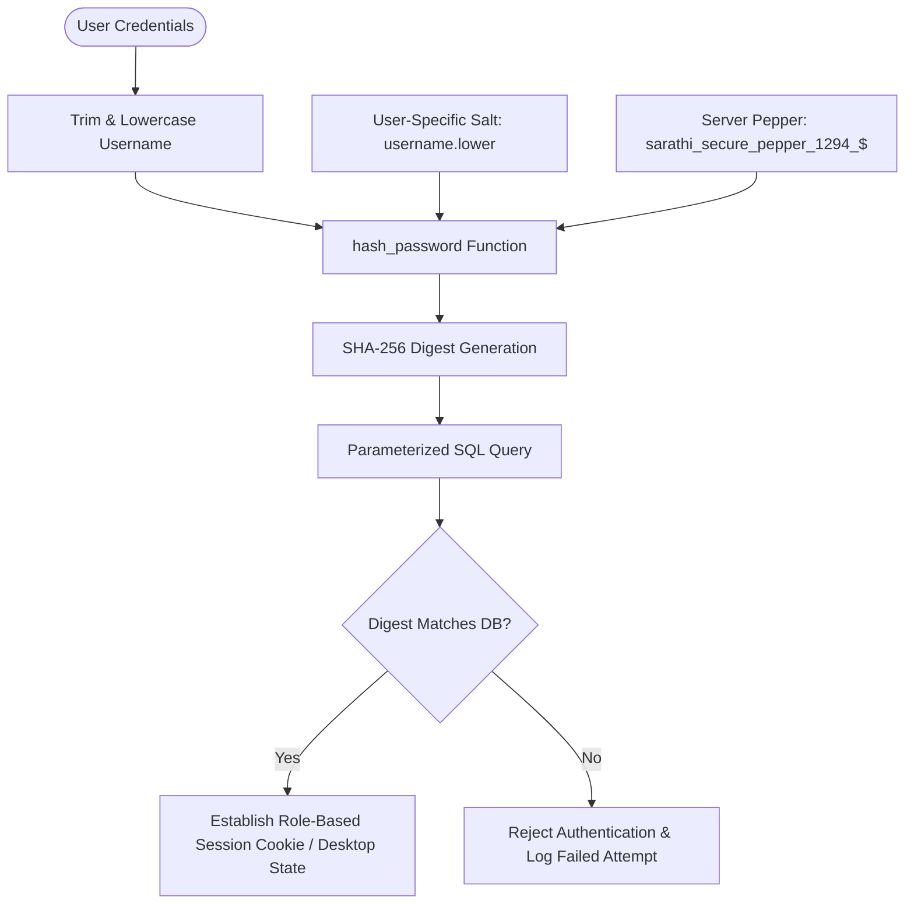

# Authentication & Security Protocols (AUTH.md) — BhagvadMood Platform

> **Document Version:** 2.0.0  
> **Security Standards:** Cryptographic Salting & Peppering (SHA-256), Role-Based Access Control (RBAC), SQL Prepared Statements, OWASP Compliance

---

## 1. Authentication Architecture

BhagvadMood Journal implements a defense-in-depth authentication framework designed to ensure user privacy, prevent credential compromise, and enforce strict role boundaries.



---

## 2. Cryptographic Password Hashing Algorithm

All passwords in BhagvadMood are hashed before being stored in the database. Raw passwords never touch database disks or log files.

```python
import hashlib

def hash_password(password: str, username: str = "") -> str:
    """
    Computes a deterministic, salted, and peppered SHA-256 hash.
    
    Salting Mechanism:
    - Pepper: Global hardcoded high-entropy secret ("sarathi_secure_pepper_1294_$")
    - Salt: Lowercase username guaranteeing distinct hashes for identical passwords across users.
    """
    pepper = "sarathi_secure_pepper_1294_$"
    combined = password + pepper + username.lower()
    return hashlib.sha256(combined.encode('utf-8')).hexdigest()
```

### Security Properties:
- **Pre-computation & Rainbow Table Resistance:** The inclusion of user-specific salt (`username.lower()`) prevents pre-computed rainbow table attacks.
- **Data Breach Containment:** If a user on another platform shares the same password, the hash stored in BhagvadMood remains unique.
- **Determinism:** Enables stateless credential comparison without transmitting keys.

---

## 3. Role-Based Access Control (RBAC)

The system defines four discrete access tiers:

| Role | Permissions & Access Boundaries | Boundary Enforcement Point |
| :--- | :--- | :--- |
| **User (Student / Professional / General)** | Compose reflections, complete PHQ-9/GAD-7 screenings, book counselor appointments, participate in peer forum, track menstrual cycles, export personal CSV. | `session.get('user_id')`, Desktop view filter |
| **Counselor** | View assigned bookings, approve/reject appointment requests, configure calendar slot availability, update counselor profile. | `session.get('role') == 'counselor'`, `CounselorDashboardFrame` |
| **Administrator** | Access audit logs, review system stats (total users, bookings, entries), manage user accounts, assign counselor credentials. | `session.get('role') == 'admin'`, `AdminDashboardFrame` |
| **Anonymous / Public** | View public landing page, read educational mental health resources, access emergency hotlines (Tele-MANAS, KIRAN). | Unauthenticated route filter |

---

## 4. SQL Injection Countermeasures

Every database query in both `Main.py`, `app.py`, and `database_setup.py` strictly utilizes parameterized prepared statements (`%s` placeholders):

```python
# SECURE (Used throughout BhagvadMood):
cursor.execute(
    "SELECT id, password FROM users WHERE username = %s",
    (username,)
)

# VULNERABLE (Strictly Prohibited):
# cursor.execute(f"SELECT * FROM users WHERE username = '{username}'")
```
This guarantees that malicious input containing SQL escape sequences (`' OR '1'='1`) is treated strictly as literal character strings by the MySQL parser.

---

## 5. Session & Cookie Security (Web Platform)

In the Flask web client (`app.py`):
1. **Cryptographic Signing:** Sessions are cryptographically signed using `app.secret_key` (configured via `FLASK_SECRET_KEY`).
2. **HTTPOnly Cookie Flags:** Session cookies are protected against client-side script inspection (XSS).
3. **Session Invalidation:** Logging out (`/logout`) explicitly calls `session.clear()`, preventing session replay attacks.

