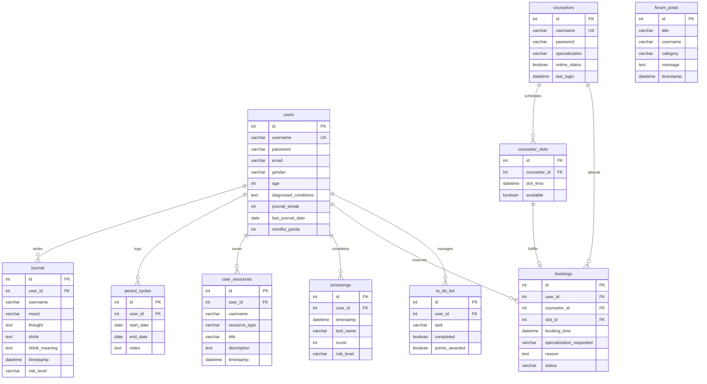

# Database Schema & Models (DATABASE.md) — BhagvadMood Journal

> **Database System:** MySQL 8.0+  
> **Database Name:** `sarathi_sih_db`  
> **Character Set:** `utf8mb4`  
> **Collation:** `utf8mb4_unicode_ci`

---

## 1. Entity-Relationship Diagram (ERD)



---

## 2. Table Specifications & Data Dictionaries

### 2.1 Table: `users`
Stores user profile, credentials, streak progress, and mindful points.

| Column | Type | Constraints | Description |
| :--- | :--- | :--- | :--- |
| `id` | `INT` | `AUTO_INCREMENT`, `PRIMARY KEY` | Unique user identifier |
| `username` | `VARCHAR(100)` | `NOT NULL`, `UNIQUE` | Case-insensitive handle |
| `password` | `VARCHAR(100)` | `NOT NULL` | SHA-256 salted and peppered digest |
| `email` | `VARCHAR(255)` | `DEFAULT NULL` | Email for notifications and password recovery |
| `gender` | `VARCHAR(20)` | `DEFAULT NULL` | Optional gender identity |
| `age` | `INT` | `DEFAULT NULL` | Age for ML resource recommendation |
| `diagnosed_conditions`| `TEXT` | `DEFAULT NULL` | Medical/wellness history notes |
| `journal_streak` | `INT` | `DEFAULT 0` | Consecutive daily journaling streak counter |
| `last_journal_date` | `DATE` | `DEFAULT NULL` | Date of last registered journal submission |
| `mindful_points` | `INT` | `DEFAULT 0` | Total gamification Mindful Points (MP) |

### 2.2 Table: `counselors`
Stores verified counseling professionals, credentials, and specialties.

| Column | Type | Constraints | Description |
| :--- | :--- | :--- | :--- |
| `id` | `INT` | `AUTO_INCREMENT`, `PRIMARY KEY` | Unique counselor identifier |
| `username` | `VARCHAR(100)` | `NOT NULL`, `UNIQUE` | Counselor login handle |
| `password` | `VARCHAR(100)` | `NOT NULL` | SHA-256 salted and peppered digest |
| `specialization` | `VARCHAR(100)` | `NOT NULL` | Clinical domain (e.g., Anxiety, Student Stress) |
| `online_status` | `BOOLEAN` | `DEFAULT FALSE` | Real-time presence indicator |
| `last_login` | `DATETIME` | `DEFAULT NULL` | Timestamp of latest session |

### 2.3 Table: `counselor_slots`
Stores calendar booking slots defined by counselors.

| Column | Type | Constraints | Description |
| :--- | :--- | :--- | :--- |
| `id` | `INT` | `AUTO_INCREMENT`, `PRIMARY KEY` | Slot identifier |
| `counselor_id` | `INT` | `NOT NULL`, `FOREIGN KEY` | References `counselors(id)` |
| `slot_time` | `DATETIME` | `NOT NULL` | Scheduled timestamp of the session |
| `available` | `BOOLEAN` | `DEFAULT TRUE` | False once reserved by a user |

### 2.4 Table: `bookings`
Stores appointment records and review statuses.

| Column | Type | Constraints | Description |
| :--- | :--- | :--- | :--- |
| `id` | `INT` | `AUTO_INCREMENT`, `PRIMARY KEY` | Booking identifier |
| `user_id` | `INT` | `FOREIGN KEY` | References `users(id)` |
| `counselor_id` | `INT` | `FOREIGN KEY` | References `counselors(id)` |
| `slot_id` | `INT` | `DEFAULT NULL` | References `counselor_slots(id)` |
| `booking_time` | `DATETIME` | `NOT NULL` | Session start time |
| `specialization_requested` | `VARCHAR(100)` | `DEFAULT NULL` | Specialty requested |
| `reason` | `TEXT` | `DEFAULT NULL` | User problem statement / summary |
| `status` | `VARCHAR(50)` | `DEFAULT 'Pending'` | 'Pending', 'Approved', 'Rejected', 'Completed' |

### 2.5 Table: `journal`
Core repository of user reflections and NLP sentiment classifications.

| Column | Type | Constraints | Description |
| :--- | :--- | :--- | :--- |
| `id` | `INT` | `AUTO_INCREMENT`, `PRIMARY KEY` | Journal entry identifier |
| `user_id` | `INT` | `FOREIGN KEY` | References `users(id)` |
| `username` | `VARCHAR(100)` | `DEFAULT NULL` | Denormalized username for rapid queries |
| `mood` | `VARCHAR(100)` | `NOT NULL` | Discrete classified mood |
| `thought` | `TEXT` | `NOT NULL` | Raw reflective entry text |
| `shlok` | `TEXT` | `DEFAULT NULL` | Associated Bhagavad Gita Sanskrit shloka |
| `shlok_meaning` | `TEXT` | `DEFAULT NULL` | English translation and practical reflection |
| `timestamp` | `DATETIME` | `NOT NULL` | Submission timestamp |
| `risk_level` | `VARCHAR(50)` | `DEFAULT 'low'` | 'low', 'medium', 'high', 'crisis' |

### 2.6 Table: `screenings`
Records psychometric evaluations (PHQ-9 and GAD-7).

| Column | Type | Constraints | Description |
| :--- | :--- | :--- | :--- |
| `id` | `INT` | `AUTO_INCREMENT`, `PRIMARY KEY` | Assessment identifier |
| `user_id` | `INT` | `FOREIGN KEY` | References `users(id)` |
| `timestamp` | `DATETIME` | `NOT NULL` | Date and time assessment taken |
| `tool_name` | `VARCHAR(50)` | `NOT NULL` | 'PHQ-9' or 'GAD-7' |
| `score` | `INT` | `NOT NULL` | Aggregate computed score |
| `risk_level` | `VARCHAR(50)` | `NOT NULL` | Clinical risk interpretation tier |

### 2.7 Table: `forum_posts`
Stores anonymous community peer support discussions.

| Column | Type | Constraints | Description |
| :--- | :--- | :--- | :--- |
| `id` | `INT` | `AUTO_INCREMENT`, `PRIMARY KEY` | Post identifier |
| `title` | `VARCHAR(255)` | `NOT NULL` | Post subject line |
| `username` | `VARCHAR(100)` | `NOT NULL` | Author display handle |
| `category` | `VARCHAR(100)` | `NOT NULL` | Topic category (e.g. Student Life) |
| `message` | `TEXT` | `DEFAULT NULL` | Content body |
| `timestamp` | `DATETIME` | `DEFAULT CURRENT_TIMESTAMP` | Post creation timestamp |

### 2.8 Table: `period_cycles`
Logs menstrual cycles for reproductive and mood correlation.

| Column | Type | Constraints | Description |
| :--- | :--- | :--- | :--- |
| `id` | `INT` | `AUTO_INCREMENT`, `PRIMARY KEY` | Cycle log identifier |
| `user_id` | `INT` | `FOREIGN KEY` | References `users(id)` |
| `start_date` | `DATE` | `NOT NULL` | First day of cycle |
| `end_date` | `DATE` | `DEFAULT NULL` | Last day of cycle |
| `notes` | `TEXT` | `DEFAULT NULL` | Physical symptoms and mood notes |

### 2.9 Table: `to_do_list`
Personal actionable task list linked to mindful rewards.

| Column | Type | Constraints | Description |
| :--- | :--- | :--- | :--- |
| `id` | `INT` | `AUTO_INCREMENT`, `PRIMARY KEY` | Task identifier |
| `user_id` | `INT` | `FOREIGN KEY` | References `users(id)` |
| `task` | `VARCHAR(255)` | `NOT NULL` | Task description |
| `completed` | `BOOLEAN` | `DEFAULT FALSE` | True when completed |
| `points_awarded` | `BOOLEAN` | `DEFAULT FALSE` | Prevents duplicate point crediting |

---

## 3. Database Initialization & Seeding

The database is initialized by running:
```bash
python database_setup.py
```
This script:
1. Connects to the host using configured environment credentials (`DB_HOST`, `DB_USER`, `DB_PASSWORD`).
2. Creates database `sarathi_sih_db` if not present.
3. Provisions all 10 tables with appropriate primary and foreign key constraints.
4. Executes safe `ALTER TABLE` schema migrations for existing databases.
5. Populates initial demo counselor accounts (`counselor1`, `dr.sharma`), default administrator (`admin`), and simulated community forum questions.

