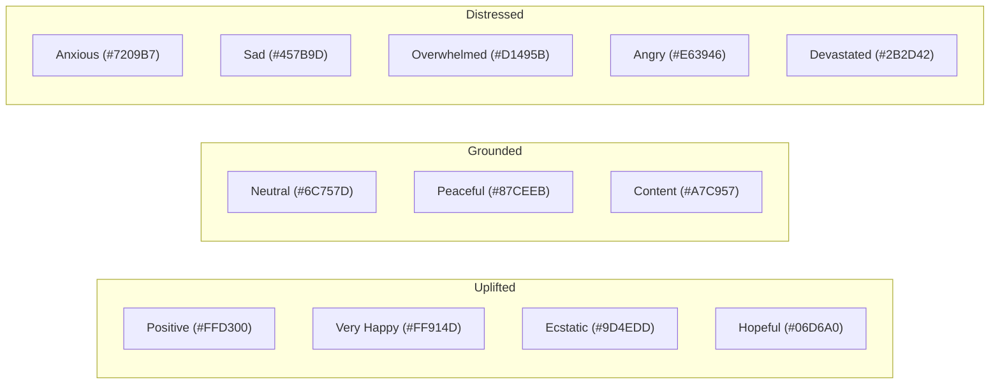

# Design Specifications Document (DESIGN.md) — BhagvadMood Journal

> **Document Version:** 2.0.0  
> **Target Platforms:** Tkinter (Desktop 1200x800) & Responsive Web (HTML5/CSS3/JavaScript)  
> **Visual Identity:** Holistic Mindful Tech with Vedic Equanimity Accents

---

## 1. Design Philosophy & Aesthetic Principles

BhagvadMood Journal marries modern dark-mode digital therapeutics with warm, grounding Vedic motifs. The interface minimizes cognitive friction, sensory overload, and visual clutter to foster a soothing, judgment-free environment for users in emotional vulnerability.

### Core Tenets:
1. **Calm Affirmation (Visual Grounding):** Avoiding abrupt saturated flashes; utilizing deep space-indigo backgrounds with soft lavender and emerald glows.
2. **Cognitive Clarity:** Strict information hierarchy separating introspective journaling, quantitative metrics, and clinical interventions.
3. **Adaptive Emotion Palette:** Dynamic color shifting reflecting the user's emotional state without inducing alarm.

---

## 2. Color System & Emotion Palettes

### 2.1 Global UI Palette (Web & Desktop)

| Variable Name | Hex Code | Purpose / UI Placement |
| :--- | :--- | :--- |
| `--bg-color` | `#0b081a` | Master viewport canvas background |
| `--gradient-start` | `#0f0b24` | Ambient radial gradient center |
| `--gradient-end` | `#17113b` | Ambient radial gradient periphery |
| `--card-bg` | `rgba(23, 18, 56, 0.65)` | Glassmorphism card fill |
| `--card-border` | `rgba(255, 255, 255, 0.08)` | Subtly illuminated borders |
| `--accent-primary` | `#8c52ff` | Primary CTA buttons, active tabs, mindful glows |
| `--accent-secondary`| `#00e676` | Success status, habit streak badges, completed goals |
| `--accent-alert` | `#ff1744` | Crisis indicators, emergency helpline banners |
| `--accent-warning` | `#ffea00` | Moderate screening risk, pending bookings |

### 2.2 Granular Mood Colors (Dynamic Theming)



---

## 3. Typography Hierarchy

- **Primary Display & Headings:** `Outfit` (sans-serif) / `Georgia` (Tkinter Desktop)  
  - H1: 32px / 28pt Bold (`#ffffff`) — Page titles, dashboard greetings
  - H2: 24px / 20pt Semi-Bold (`#8c52ff`) — Section cards, screening headers
  - H3: 18px / 15pt Medium (`#a5a1ca`) — Component labels, stats counters
- **Body & Reflective Text:** `Inter` (sans-serif) / `Segoe UI` (Desktop)  
  - Body Regular: 15px / 11pt Regular (`#e0e0e0`) — Journal inputs, forum discussions
  - Caption / Meta: 12px / 9pt Light (`#7e7a9e`) — Timestamps, helpline numbers
- **Wisdom Quotes & Shlokas:** `Nirmala UI` / `Georgia` (Italic)  
  - Sanskrit Script: 18px Bold (`#ffd700` Gold Accent)
  - English Translation: 14px Italic (`#ffffff`)

---

## 4. Component Design & Layout Systems

### 4.1 Desktop (Tkinter Frame Architecture)
The desktop application encapsulates 27 distinct frames within a centralized grid-swapping container (`SarathiApp` inheriting from `tk.Tk`):

```
+--------------------------------------------------------------------------+
|  Top Brand & Nav Header (Logo, Mindful Points, Streak Badge, Logout)    |
+-------------------+------------------------------------------------------+
|                   |                                                      |
|   Sidebar Navigation   |             Active Frame Container                   |
|   - Chat & Journal|   (Dynamic switching via app.show_frame)             |
|   - Screenings    |                                                      |
|   - Counselor     |   - Modern ScrolledText for reflections              |
|   - Peer Forum    |   - Matplotlib FigureCanvasTkAgg for charts          |
|   - Resources     |   - Treeview with custom ttk styles for tables       |
|   - Cycle Tracker |   - Animated Canvas for Spin the Wheel               |
|   - To-Do Notes   |                                                      |
|                   |                                                      |
+-------------------+------------------------------------------------------+
|  Crisis Emergency Footer Strip (Tele-MANAS: 14416 | KIRAN: 1800-599-0019)|
+--------------------------------------------------------------------------+
```

### 4.2 Web (Responsive Bootstrap/Glassmorphism Architecture)
- Built on a fluid 12-column CSS Grid / Flexbox container layout.
- Glassmorphism backdrop filter (`blur(16px)`).
- Collapsible responsive sidebar with SVG icons.
- Micro-interactions: 1.1x brightness on hover, pulse animations on crisis warning badges.

