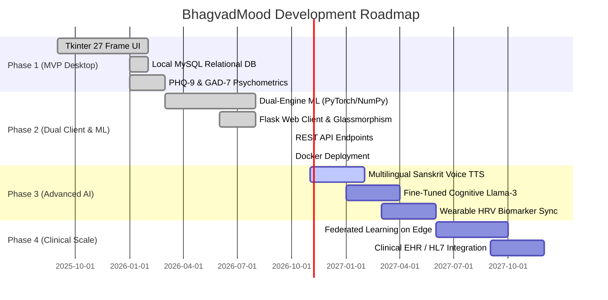

# Feature Development Roadmap (FEATURES.md) — BhagvadMood Platform

> **Document Version:** 2.0.0  
> **Development Lifecycle:** Iterative Milestone Progression from Local Desktop MVP to Enterprise Mental Health Ecosystem

---

## 1. Feature Progress Matrix

---

## 2. Completed Milestones (Phases 1 & 2)

### 2.1 Multi-Persona Authentication & Privacy
- [x] Separate login workflows for Students, Professionals, Non-Professionals, Counselors, and Administrators.
- [x] Salted and peppered cryptographic password hashing with SHA-256.
- [x] 100% offline local MySQL persistence with zero third-party telemetry.

### 2.2 Dual-Client User Experience
- [x] **Desktop Client (`Main.py`):** 27 Tkinter frames featuring embedded Matplotlib analytics, treeview search, and in-app Bhagavad Gita PDF viewer.
- [x] **Web Client (`app.py`):** Modern glassmorphism HTML5/CSS3 interface with responsive navigation, Jinja2 templating, and REST API endpoints (`/api/health`, `/api/sentiment`).

### 2.3 Cognitive Reframing & Vedic Wisdom
- [x] Multidimensional sentiment scoring (Polarity, Subjectivity, Negation Inversions).
- [x] Granular 20-mood classification.
- [x] Situational context tagging (Academic, Career, Relationships, Health, Finance, Self-Esteem, Grief).
- [x] Contextual Bhagavad Gita Sanskrit Shloka pairing with authentic commentaries.

### 2.4 Machine Learning Dual-Engine
- [x] PyTorch deep neural network integration for sentiment and crisis inference.
- [x] Pure NumPy analytical He-initialized fallback networks (`TextNeuralNetwork`, `NumPySequential`) utilizing portable JSON weights.
- [x] Personalized 5-feature biological and psychological resource recommendation model.

### 2.5 Harm Prevention & Safety
- [x] Automated suicide ideation and acute medical distress pattern detection.
- [x] Immediate emergency intervention modal routing users to Tele-MANAS (`14416`), KIRAN (`1800-599-0019`), and Emergency (`112`).

### 2.6 Holistic Wellness Tools
- [x] PHQ-9 Depression and GAD-7 Anxiety standardized clinical inventories.
- [x] Menstrual cycle tracking and symptom/mood logging.
- [x] Gamified Mindful Points (MP), habit streaks, and level progression badges.
- [x] Moderated anonymous peer community forum.
- [x] Interactive Spin the Wheel affirmation generator.
- [x] CSV data export functionality.

---

## 3. Future Roadmap (Phases 3 & 4)

### Phase 3: Multilingual Voice & Local Fine-Tuned LLMs (Q1-Q2 2027)
- **Voice Synthesis:** Native Sanskrit chanting voice synthesis (TTS) for paired Shlokas using Coqui TTS / Bark.
- **Local Small Language Models (SLM):** On-device quantized Llama-3-8B / Mistral-7B fine-tuned on cognitive reframing datasets for conversational therapy without cloud dependencies.
- **Multilingual Support:** Hindi, Marathi, Tamil, Bengali, and Gujarati interfaces.

### Phase 4: Biometric Integration & Clinical Telemetry (Q3-Q4 2027)
- **Wearable Sensor Integration:** Real-time Heart Rate Variability (HRV), galvanic skin response, and sleep cycle correlation using Bluetooth Low Energy (BLE) APIs.
- **Clinical EHR / HL7 FHIR Bridge:** Secure interoperability standard allowing counselors to export anonymized longitudinal mood logs to clinical Electronic Health Record (EHR) systems.

