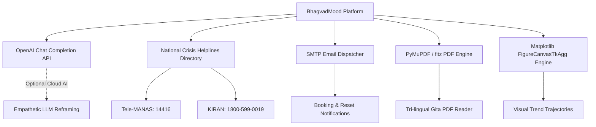

# Third-Party Integrations (INTEGRATIONS.md) — BhagvadMood

> **Document Version:** 2.0.0  
> **Ecosystem:** External AI APIs, National Crisis Hotlines, SMTP Mailers, Document Parsers, Visual Rendering

---

## 1. External Integrations Matrix

---

## 2. Integration Specifications

### 2.1 OpenAI Chat Completion API (Cognitive Reframing)
- **Role:** Optional cloud-assisted empathetic dialogue generation.
- **Library:** `openai>=1.12.0`
- **Environment Variable:** `OPENAI_API_KEY`
- **Model:** `gpt-3.5-turbo` (with JSON mode response format: `response_format={"type": "json_object"}`)
- **Timeout:** 5 seconds strict timeout.
- **Fault-Tolerance Policy:** If the key is missing, network is unavailable, or OpenAI times out, the platform gracefully switches to local deterministic NLP and Vedic Shlokas without error dialogs.

### 2.2 National Emergency Crisis Helplines
- **Role:** Direct safety intervention when crisis indicators or acute medical distress are detected.
- **Integrated Services:**
  - **Tele-MANAS:** National Tele Mental Health Programme of India (`14416` / `1-800-891-4416` — 24/7 Free & Confidential)
  - **Vandrevala Foundation Helpline:** `+91 9999666555` (24/7 Professional Counseling)
  - **KIRAN Helpline:** `1800-599-0019` (Ministry of Social Justice 24/7 Helpline)
  - **National Emergency Number:** `112` (Police, Ambulance, Fire)
- **Implementation:** Hardcoded directory within `HELPLINES` dictionary ensuring offline accessibility during total network outages.

### 2.3 SMTP Email Notification Engine
- **Role:** Sends appointment confirmations between users and counselors, and issues password reset verification codes.
- **Protocol:** Standard SMTP over TLS (Port 587) or SSL (Port 465).
- **Configuration Storage:** Managed dynamically via local `smtp_config.json` or environment variables (`SMTP_HOST`, `SMTP_PORT`, `SMTP_USER`, `SMTP_PASS`, `EMAIL_FROM`).
- **Templates:** Configurable templates for session confirmations and security codes.

### 2.4 PyMuPDF (`pymupdf` / `fitz`)
- **Role:** High-performance, memory-efficient PDF rendering.
- **Asset Rendered:** `BhagavadGita_Tri-lingual.pdf` (53.8 MB Sanskrit, Hindi, English edition).
- **Fallback:** If `tkinterPdfViewer` encounters missing dependencies, a lightweight notification widget renders while preserving all other screen features.

### 2.5 Matplotlib (`matplotlib.backends.backend_tkagg`)
- **Role:** Visual data analytics embedded directly within the Tkinter canvas holder.
- **Outputs:**
  - 3D-styled mood distribution pie charts with percentage slices.
  - Longitudinal mood polarity line graphs showing 7-day and 30-day psychological trajectories.
- **No GUI Block:** Renders cleanly inside `FigureCanvasTkAgg` without triggering separate Matplotlib figure windows.

